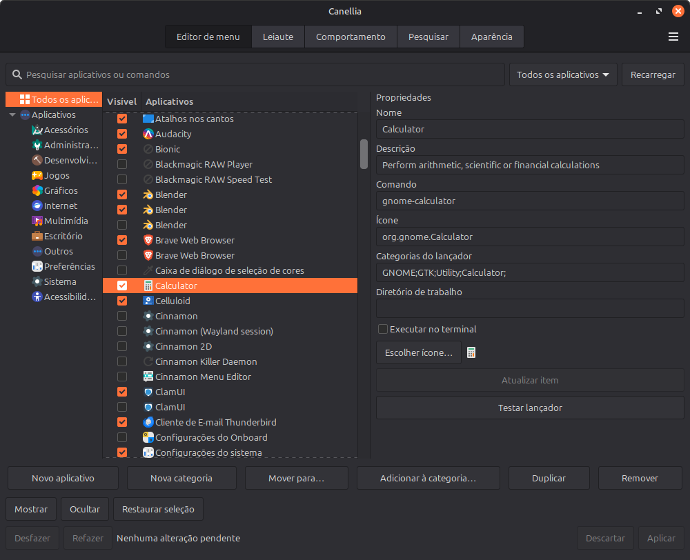

Canellia
========
_Version: 5.6.4 (local, unreleased)_ (installation and search robustness)

Canellia is a full featured alternative to the standard Cinnamon menu with grid layout, an integrated menu editor and customisation options.

The applet UUID and translation domain are `Canellia@json`.

### To install or update this checkout:

Run in a Cinnamon session (Python 3.8+ and `flock` required):

```sh
bash install.sh --local --force
```

The local mode installs this checkout, including the robustness fixes. Running
`bash install.sh` without flags also installs this checkout. Remote installs require
explicit `--archive HTTPS_URL --metadata-url HTTPS_URL` arguments for a Canellia package.
Installation validates files before replacing the applet and restores the
previous installation if activation fails.

For architecture, automated checks and desktop release validation, see
[DEVELOPMENT.md](DEVELOPMENT.md). Run `python3 scripts/check.py` with Node.js 22+
and gettext installed to execute the regression suite.

### Features

 * Own menu editor in the first settings tab, with search, filters, multiple
   selection, drag/move/add to categories, inline properties, icon choice,
   launcher creation/testing and individual restore. Changes are staged until
   Apply, with Discard, Undo/Redo, conflict checks and automatic backups.
 * The Tips tab has been removed.

 * Fuzzy searching for app names, with accent-insensitive matching and exact
   names ranked above partial matches.
 * The editor displays file and theme icons. Removed system launchers stay
   available through the Hidden filter for restoration. Flatpak launcher aliases
   share one canonical desktop ID.
 * Filesystem browser and home directory file search.
 * Emoji browser & search.
 * Customisation options:
   * Resizable.
   * View apps in a list or grid.
   * Options on where to show session and favorite app buttons.
   * Change icon sizes.
 * Browser bookmarks and history search
 * Web search suggestions & Wikipedia search.
 * Built in calculator with calculator history. This is evaluated as a javascript expression so all javascript operators and Math functions are valid, including constants: E, PI and functions (trig) sin, asin, sinh, asinh, cos, tan, etc. and cbrt, exp, floor, log, log10, pow, random, round, sqrt, etc. All angles are in radians. (see [here](https://developer.mozilla.org/en-US/docs/Web/JavaScript/Guide/Expressions_and_Operators) for list of operators and [here](https://developer.mozilla.org/en-US/docs/Web/JavaScript/Reference/Global_Objects/Math) for list of constants and functions)


----

#### Key navigation (optional)
 * `Return/Enter` — Activate currently highlighted item (same as left clicking on item.)
 * `Ctrl-Enter/Menu key` — Open/close context menu of currently highlighted item.
 * `Arrow keys/pg up/pg down` — navigate between items.
 * `Tab/Shift-Tab` — navigate between apps ⇨ categories ⇨ sidebar.
 * `Esc` — Close menu or context menu.

#### Expert features (optional)
 * `Shift-Enter` — Run currently highlighted application as root user.
 * `Ctrl-d` — Open .desktop file of currently highlighted app in default text editor (opens file in user mode.)
